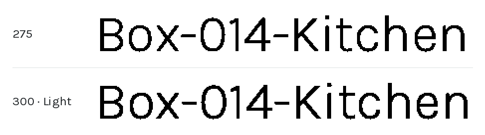

# PlatenKit

PlatenKit is a Swift package for printing Bluetooth labels on macOS and iOS. Give it a complete image, or compose a label from text, artwork and a QR payload. The Mac CLI and the SwiftUI iPhone example share the same renderer, Bluetooth transport and printer adapters.

Add the **PlatenKit** library product to your app and use `import PlatenKit`. All commands below run from the directory containing [Package.swift](Package.swift). You can render your first PNG with the printer switched off. [Quickstart and Swift integration example](QUICKSTART.md)

| Printer | Adapter | Verified physical output from macOS |
| --- | --- | --- |
| Rongta RP421A | ZPL graphics | Readable bitmap text and dithered artwork on 4 × 2 inch stock |
| Labelife AM-243-BT (PM-241-BT) | TSPL mode-4 bitmap | Readable text, a scannable QR and dithered artwork on 4 × 6 inch stock |

The iPhone bench builds against the same package. Physical iPhone trials through PlatenKit are still pending for both models. [Mac paper comparison](BenchRuns/2026-11-23-moon-0132Z/README.md) · [iPhone test procedure](#real-iphone-acceptance)

## Print one Labelife label from the Mac

The bench unit advertises as `AM-243Z-BT-5AD6`. Its sticker says AM-243-BT and its hardware identifier is PM-241-BT. The loaded stock is 4 inches across the print head and 6 inches along the feed, or 101.6 × 152.4 mm. The manufacturer’s iPhone app printed successfully. Disconnect that app before using the bench. The Mac connected from the probe with its Bluetooth Settings left alone.

Run these commands from the package directory. Copy the UUID reported by this Mac into `printer_id`. Scan and inspect are read-only. The last command prints one plain label with a fresh ID.

```zsh
swift run printer-bench scan --match 243
printer_id='UUID-FROM-THIS-MACS-SCAN'
swift run printer-bench inspect --device "$printer_id"
swift run printer-bench smoke --model labelife --device "$printer_id" --width-mm 101.6 --height-mm 152.4
```

To print the design used for the QR proof, make a separate request. The default artwork is an outlined square marked in one corner so orientation is visible. `--artwork path.png` supplies different artwork.

```zsh
swift run printer-bench test-label --model labelife --device "$printer_id" --width-mm 101.6 --height-mm 152.4
```

To preview the design offline, supply a new PNG filename. To print a fully composed page, use `image`. The image command preserves its contents, so its journal ID can differ from text already present in the image.

```zsh
swift run printer-bench preview --width-mm 101.6 --height-mm 152.4 --run-id PK-CONTROL --output control.png
swift run printer-bench image --model labelife --device "$printer_id" --width-mm 101.6 --height-mm 152.4 --file control.png
```

## Choose the label font

PlatenKit draws the text on the Mac or iPhone at the stock’s print resolution. The Rongta receives the resulting dots as a ZPL graphic, and the Labelife receives them as a TSPL bitmap. The same font choice applies to an ID-only label and to the title on an artwork-and-QR label. A pre-rendered image carries its own lettering.

Use `--font Karla --font-weight 275` for the bundled upright Karla. Its OpenType weight axis covers 200 through 800, including Light at 300. For another face, use its exact PostScript name, such as `--font Courier-Bold`, or pass a standalone font with `--font-file /path/to/face.ttf`. The file can also be OpenType (`.otf`). Set a numeric weight for a font with a variable weight axis. Fixed-weight faces use the weight in their file or name. An unavailable face, unsupported weight, or character the selected font cannot draw produces an error before submission. With no font selected, the renderer keeps the original Helvetica Bold layout. [Karla font metadata](https://raw.githubusercontent.com/google/fonts/main/ofl/karla/METADATA.pb) · [Bundled font license](Sources/PlatenKit/Resources/OFL.txt)

For an offline preview of the 4 × 2 inch roll, use a new PNG filename. `--monochrome` exports the same black and white dots the print adapters use, including their threshold for converting gray edges to black or white.

```zsh
swift run printer-bench preview --width-mm 101.6 --height-mm 50.8 --dpi 203 --run-id Box-014-Kitchen --font Karla --font-weight 275 --monochrome --output karla-275.png
```

The same font flags work with `smoke` and `test-label`. On the Rongta, omit the native text diagnostic’s `--language` switch when choosing a font. In the iPhone harness, enter `Karla` in **Font** and `275` in **Variable weight**, or tap **Choose font file** to load a face from Files for this session. [Swift integration example](QUICKSTART.md#3-wire-scan-connect-print-and-disconnect)

### Karla 275 and 300 on 4 × 2 inch stock

Both example labels contain `Box-014-Kitchen` at the same size, with the same artwork and QR payload. The enlarged crops show the printer dots at twice their native size. For this title, 275 uses 3,151 black dots and 300 (Light) uses 3,289. The QR and artwork match pixel for pixel. [Full 275 label](Examples/Fonts/Karla-275.png) · [Full 300 label](Examples/Fonts/Karla-300.png)



For each weight, the ZPL graphic and the decompressed TSPL bitmap were checked offline against all 812 × 406 dots in the corresponding PNG. Each PNG’s QR decoded to `Box-014-Kitchen`. The examples use 4 × 2 inch stock for both encoders to keep the comparison at one physical size. To regenerate the 300 sample, change the preview command above to `--font-weight 300 --output karla-300.png`.

To give fine lettering more printer dots, specify a physical size with `--font-size-pt 24` or the iPhone bench’s **Size (pt)** field. The renderer converts points to dots using the stock’s DPI and reports a fit error if the text exceeds the page. On the 4 × 2 inch roll, Karla 275’s automatically fitted title uses about 18.7 pt and occupies 37 rows of ink. At 24 pt the same title spans 48 rows. The QR and artwork in these examples match pixel for pixel. In an offline comparison at the smaller size, snapping the glyphs to whole-dot positions reproduced the existing pixels, and error diffusion added visible stippling to the letter edges. [Title and edge comparison](Examples/Fonts/Karla-print-sizes.png) · [24 pt at 275](Examples/Fonts/Karla-275-24pt.png) · [24 pt at 300](Examples/Fonts/Karla-300-24pt.png)

## Print photographs

Use `--image-mode photo` for photographs. The renderer fits the picture to its final size at the stock’s DPI and uses Floyd–Steinberg dithering to represent intermediate tones with patterns of black dots. On paper, the dithered Moon preserved more surface detail on both printers. The Swift renderer reproduced every dot in the 284 × 284 picture used for each physical print. [Side-by-side paper results](BenchRuns/2026-11-23-moon-0132Z/README.md) · [Grayscale Moon used by the regression test](Tests/PlatenKitTests/Fixtures/moon-gray-284.png)

To preview a photograph alongside a Karla title and a QR code, run this from the package directory and choose a new output filename. The preview is an 812 × 406 pixel image of the actual print dots and works with the printers off.

```zsh
swift run printer-bench preview --width-mm 101.6 --height-mm 50.8 --run-id Box-014-Kitchen \
  --font Karla --font-weight 275 --font-size-pt 24 \
  --artwork Tests/PlatenKitTests/Fixtures/moon-gray-284.png --image-mode photo \
  --monochrome --output moon-preview.png
```

On a composed label, `preview` and `test-label` apply the mode only to the supplied artwork. The Swift equivalent is `LabelRenderer.compose(artwork:text:qrPayload:stock:font:artworkMode:)` with `artworkMode: .photo`. In the iPhone bench, choose the artwork file and select **Photograph** under **Artwork type**. The title keeps its chosen font and the QR keeps its solid modules. The default `.lineArt` suits logos, codes and pages that are already prepared as black and white dots.

For a standalone photograph without a title or QR, pass `--file path.jpg --image-mode photo` to the Mac’s `image` command or use `LabelJob.image(picture, id: runID, model: model, stock: stock, mode: .photo)` in Swift. A precomposed one-bit label such as either archived Moon comparison can go directly through `image` with its default settings.

## Physical evidence

The Mac runs below took place on November 20, 2026, on macOS 27.3 (26C5047e) using Core Bluetooth. The bench generated jobs at 203 dpi. Each Bluetooth print started from a fresh scan of the selected printer. The Labelife roll was 4 × 6 inches. The Rongta roll was 4 inches wide by 2 inches high (101.6 × 50.8 mm).

| Unit and run | Submission | Observed paper |
| --- | --- | --- |
| Labelife, vendor iPhone app | Manufacturer app test | James confirmed a successful print. |
| Labelife, `WL-L1-1904` | TSPL native text, 105 bytes acknowledged | No movement. The current ID-only command renders its text as a bitmap. |
| Labelife, `WL-L2-QR-1906` | TSPL mode-4 artwork, text and QR, 17,091 bytes in 71 acknowledged writes | Exactly one good label. James scanned the paper QR and read `WL-L2-QR-1906`. |
| Labelife, `WL-L3-1920` | Reconnected, selected the default profile, sent a raster ID, 3,302 bytes in 15 acknowledged writes | Exactly one readable label bearing `WL-L3-1920`. |
| Rongta RP421A, `WL-R1-1842` | ZPL, 42 bytes acknowledged on `18F0/2AF1` | Stock advanced with a blank or incorrect label. The vendor iPhone app could also advance stock. |
| Rongta RP421A, `WL-R2-2122` | One 88-byte ZPL write for a centered black square and ID, acknowledged on `18F0/2AF1`. The SDK status query received zero reply bytes before and after. | James saw the paper feed and confirmed that the label had no marks. [Timestamped trace and paper observation](BenchRuns/2026-11-20-rongta-2117Z/README.md) |
| Rongta RP421A, power-on self-test | The Mac had disconnected. James used the FEED button and power switch. | Stock advanced with at most a tiny line, followed by motor or roller noise. The thermal face darkened when scratched and was loaded face up. James found the visible path and roller clear. |

On November 22, the Rongta printed its built-in self-test with the correct power supply. The photographed page reports `RP421`, firmware `V4.31` (2024-01-30), ZPL and 203 dpi. James recalls that page was on the larger roll. He repeated the self-test on the confirmed 4 × 2 inch roll, where it printed on one label and stopped at its end. On the same stock and supply, the Mac’s `WL-R3-2350` on `18F0/2AF1` and `WL-R4-2359` on `FF00/FF02` each received an 88-byte write acknowledgement and fed completely blank paper. [Self-test and first endpoint](BenchRuns/2026-11-22-rongta-2349Z/README.md#built-in-self-test-on-both-rolls) · [Second endpoint and trace](BenchRuns/2026-11-22-rongta-2359Z/README.md)

James then confirmed a physical iPhone print from **RT Elabel**, the app Rongta lists for the RP421A. He selected ZPL in the app. Its published version history also documents a TSPL default for the RP421 profile. On the 4 × 2 inch roll the Mac subsequently sent one native text ID per language through `18F0/2AF1`. [RT Elabel evidence and both text traces](BenchRuns/2026-11-23-rongta-0025Z/README.md) · [Publisher’s version history](https://apps.apple.com/us/app/rt-elabel/id6714471637)

On the watched repeats, native ZPL text advanced one blank label and native TSPL text produced no movement. The next job used the same endpoint and stock, rendered `WL-G9-0035` as a ZPL bitmap and explicitly set the 812 × 406 dot page dimensions and origin. All 82,882 bytes were acknowledged in 162 writes. James confirmed the first physical Rongta print from the Swift bench. [Source PNG, trace and reproduction command](BenchRuns/2026-11-23-rongta-0036Z/README.md)

Later that evening, the Labelife printed one `WL-LIMG-013140` and the Rongta printed one `WL-RIMG-013140`. Both used the same 35.5 mm Moon pictures. James photographed the two results together and preferred the dithered picture on each. [Paper photograph, exact input pages and write receipts](BenchRuns/2026-11-23-moon-0132Z/README.md)

### Labelife wire format

The selected unit advertised `1812` and `AF30`. Service discovery after connecting found `FF00/FF02` for writes and `FF00/FF03` for notifications. Automatic selection checks the AM-243 or PM-241 Bluetooth model name and the properties of both characteristics. The CLI accepts an explicit service/characteristic from the current inspection for a separately identified variant.

The adapter subscribes to `FF03` before sending the job. The printer initially granted seven write credits (`01 07`) and reported a 244-byte packet limit (`02 F4 00`). One credit permits one packet. The component waits for new credits as needed and also enforces Core Bluetooth’s write limit and flow control for the selected write mode. Both verified runs used writes with response. Ordinary print messages, including `SSSGETPRINTING:DOING` and `Cmd error` lines, are assembled across notifications and appear in the journal. The component sends no status poll. This unit rejected explicit polling during the bench tests.

The TSPL job sets page dimensions and direction, clears the image buffer, sends `BITMAP 0,0,<row bytes>,<rows>,4,`, then issues `PRINT 1,1` once. The adapter packs the image MSB first with a zero for ink and white row padding. Each 4,096-byte slice is independently LZO1X encoded and prefixed with its compressed length as a 32-bit little-endian integer. A zero length terminates the stream. The AM-243-BT and PM-241-BT-Bluetooth driver profiles used during the bench investigation use this same framing. The 4 × 6 design is 812 × 1,218 dots with a 102-byte stride. The Swift encoder runs on both platforms without an external compression library.

### Rongta bench

Find the unit by name and take its UUID from this Mac’s current scan.

```zsh
swift run printer-bench scan --match RP421 --seconds 15
printer_id='UUID-FROM-THIS-MACS-SCAN'
```

To print one ID on the 4 × 2 inch roll, run the command below. It draws a fresh ID as a bitmap, sets the ZPL page dimensions and origin, and requests one copy. On this unit the default profile selects the advertised `18F0` service and the writable `2AF1` characteristic. The 4 × 2 inch page took about 43 seconds to transfer in the confirmed run. [First print, source image and timing](BenchRuns/2026-11-23-rongta-0036Z/README.md)

```zsh
swift run printer-bench smoke --model rongta --device "$printer_id" --width-mm 101.6 --height-mm 50.8 --seconds 15
```

For a command-language diagnostic, add `--language zpl` or `--language tspl`. Each invocation sends one ID in the printer’s built-in font using its current media settings, and logs the outgoing bytes, write acknowledgements and any incoming notifications. On this unit the ZPL diagnostic fed blank stock and the TSPL diagnostic produced no movement. [Native-text comparison](BenchRuns/2026-11-23-rongta-0025Z/README.md)

```zsh
swift run printer-bench smoke --model rongta --device "$printer_id" --language zpl --endpoint 18F0/2AF1 --width-mm 101.6 --height-mm 50.8
```

The status command connects, subscribes to the SDK’s matching reply characteristic and sends an 11-byte `~HQPRNSTA\r\n` query. The SDK documents this query for the related RP410. On the RP421A bench unit the Mac successfully subscribed to both documented channels present on the printer. Each acknowledged the query and returned zero notification bytes during the three-second observation window. These traces establish the Bluetooth exchange. The unit’s error state and internal job history remain unknown. [Status traces](BenchRuns/2026-11-20-rongta-2117Z/README.md)

```zsh
swift run printer-bench rongta-status --device "$printer_id" --endpoint 18F0/2AF1 --seconds 15
```

For a separately requested paper test, `rongta-mark` sends one ZPL format containing a solid 64-dot square and a separate text ID on the 4 × 2 inch stock. It preserves the printer’s existing media and darkness settings. It keeps the receive channel open before, during and after submission, including a status query on each side of the print. Run IDs are generated automatically unless `--run-id` is supplied. Use a fresh log filename for each run.

```zsh
set -o pipefail
swift run printer-bench rongta-mark --device "$printer_id" --endpoint 18F0/2AF1 --width-mm 101.6 --height-mm 50.8 --seconds 15 2>&1 | tee "rongta-$(date -u +%Y%m%dT%H%M%SZ).log"
```

`HOST TX` shows the exact bytes submitted, `GATT ACK` records the Bluetooth write callback, and `PRINTER RX` records each notification delivered from the selected reply channel in hex and escaped text. Record the paper observation alongside the trace. The SDK maps `18F0/2AF1` to `18F0/2AF0`, `FF00/FF02` to `FF00/FF01`, and `FFE0/FFE1` to itself. Automatic selection uses the advertised service when it resolves an ambiguity. An explicit endpoint must exist in the current inspection.

If a label feeds entirely blank, the RP421A can print a self-test independently of the Mac. With the roll loaded and the lid closed, turn the printer off, hold FEED while switching it on, then release FEED after power-on. Record whether the printer marked the paper and any firmware version, command mode or resolution shown on the page. The shipping-model guide lists Bluetooth, ZPL, 203 dpi and a 24 V DC, 2.5 A adapter. The case label and the self-test identify the actual unit. [Rongta RP421A shipping manual, printed pages 8, 25 and 26](https://cdn.shopify.com/s/files/1/0933/9538/6655/files/40800507RP421A-_-V1.5.pdf?v=1791877401)

## Use the Swift library

Add the local package and depend on its `PlatenKit` product. Keep one `BluetoothPrinter` on the main actor. Call `scan()` when the operator asks, display its results and retain the selected `NearbyPrinter` on that same instance. Invoke the following from an explicit print action. Upstream SVG artwork can be rendered to a `CGImage` before calling the component.

```swift
import CoreGraphics
import PlatenKit

@MainActor
func printBox(_ runID: String, artwork: CGImage?, selected: NearbyPrinter,
              using radio: BluetoothPrinter) async throws -> Submission {
    let stock = try LabelStock(widthMM: 101.6, heightMM: 152.4, dpi: 203)
    let page = try LabelRenderer.compose(artwork: artwork, text: runID, qrPayload: runID, stock: stock)
    let job = try LabelJob.image(page, id: runID, model: .labelife, stock: stock)
    try await radio.connect(selected.id)
    defer { radio.disconnect() }
    let endpoints = try await radio.inspect()
    let endpoint = try PrinterEndpoint.select(for: .labelife, in: endpoints,
                                              advertisedServices: selected.advertisedServices,
                                              peripheralName: selected.name)
    return try await radio.submit(job, to: endpoint)
}
```

Use `LabelJob.newID()` for a fresh bench ID with the prefix `PK-`, or supply 1–32 ASCII letters, digits, hyphens or underscores as your own ID. `LabelJob.image` aspect-fits a complete page onto white stock. `compose` adds caller text, artwork and a QR before thresholding. `Submission` reports the run ID, byte count, chunk count and whether the transport acknowledged or queued the writes. Set `radio.onEvent` to record connection events, device messages and errors. If a disconnect or timeout occurs after any bytes were submitted, the component reports an uncertain outcome. Check the paper before explicitly requesting another label.

## Build and verify

Use Swift 6 with the macOS and iOS SDKs. The package targets macOS 13 and iOS 16 or later and has no external package dependencies. From this directory, the following commands exercise the component without accessing a printer.

```zsh
swift test
swift build -c release
swift run printer-bench help
```

The tests cover complete Labelife pages, LZO block boundaries and byte polarity, odd-width padding, ZPL field limits, supplied artwork, QR module layout, profile selection, packet credits, queued and acknowledged writes, cancellation, stale completions and interrupted submissions. For the Rongta, they check that the default ID uses the rendered image bytes and one copy on 4 × 2 inch stock. Separate diagnostics check the built-in font commands, SDK query bytes, three mapped reply endpoints, byte trace and square-and-text label. An independent bench check also decompressed the actual Labelife QR job with liblzo2, compared every raster dot with the PNG, and decoded the QR from those bytes. liblzo2 is only needed to repeat that independent comparison.

The included Xcode project references the package at the repository root. With Xcode and the iOS SDK installed, compile the shared scheme for a generic iPhone without signing.

```zsh
xcodebuild -project BenchApp/PrinterBench.xcodeproj -scheme PrinterBench -destination 'generic/platform=iOS' CODE_SIGNING_ALLOWED=NO build
```

To run the bench on your own iPhone, select your development team in **Signing & Capabilities** and replace the example bundle identifier `org.example.platenkit.printerbench` with one your team can sign. The project includes the Bluetooth usage description. The operator chooses each print explicitly.

## Real iPhone acceptance

Select the model, tap **Scan nearby**, choose the unit, then **Connect and inspect**. Leave **Match printer profile** selected for this Labelife. Use **Print artwork, text and QR** for each acceptance run. The app saves its journal across launches. Use **Paper check** to record the label count, readable text and artwork, and the QR scanned from the label. **Share full journal** exports the results.

For each printer, request one label on the initial connection, one after disconnecting and reconnecting, and one after restarting the printer and relaunching the app. Use a fresh ID each time. Each request must produce exactly one label on the selected unit, with the QR decoding to its run ID. Log host OS, app and firmware versions when known, stock, transport, command language, discovery, endpoint, write result, and physical observation.
